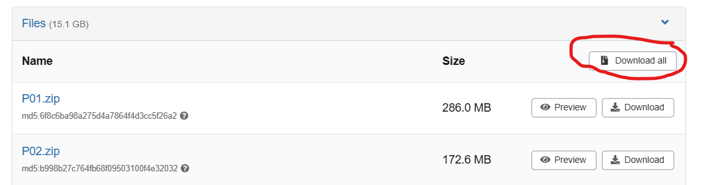

# TumorFlow
* Création d'un environnement virtuel

Créer un environnement virtuel permet d'éviter les conflits de versions des bilbiothèques Python. 

Etape n1: 
``` 
python -m venv EnvVirtuel
```
Etape n2:
```
.\EnvVirtuel\Scripts\activate
```
Etape n3:
```
pip install -r .\requirements.txt
```

* Téléchargement du Dataset

Pour telecharger le dataset il suffit de se rendre sur le site web suivant:

[](https://doi.org/10.5281/zenodo.17253793)

Et ensuite, télécharger le dossier complet.


Une fois le dossier téléchargé, veuillez le dézipper dans le dossier de travail.